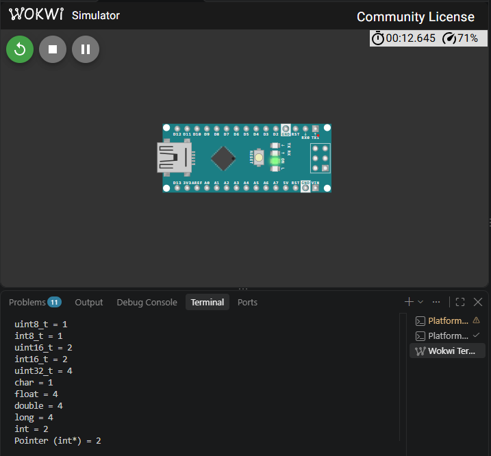
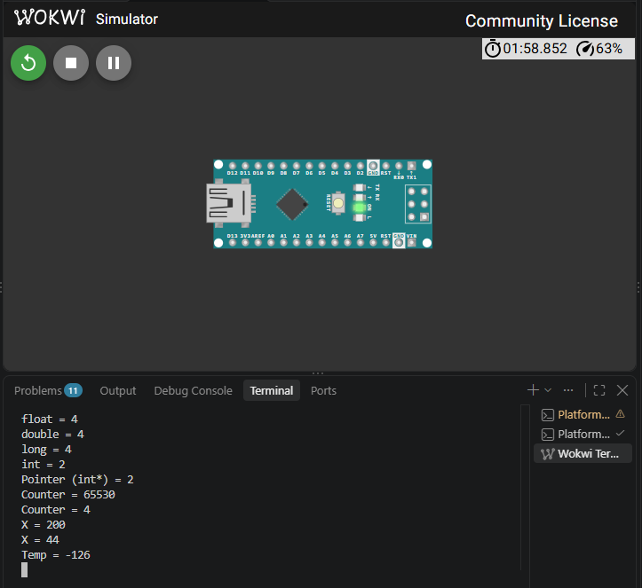

There are 2 questions that need to be answered in this section:
1. What determines the size of a pointer in arduino?
2. What determines the size of an "int" varaible across different architectures?

                      ANSWERS
1. The size od a pointer is determined by the address bus of that architecture(in this case arduino). The pointer is determined by the number of addressable memory locations.

An arduino has 2048 addressable meory locations, which are numbered from 0 to 2047. We want to number all these locations or give them a label or address to easily find them. But at the moment they are all numbered in decimal(or should i say normal human numbering from 1-10(base 10)).

But noww, a problems arises; Compuuters do not understand base 10, nor can they process human numbering on their own.SO what do we do? We operate in the language of computers which is base 2 or Binary as we famously call it. But then that means we have to convert each of those decimal numbers/addresses/;abels to its binary equivalent.

Now, we are not here to find the binary equivalent of each of the addresses present between 0-2027(they are altogehter 2048 addresses).
We simply want to find the binary equivalent of the largest number(2047) which allows us to know the arduino address bus width. The arduino address bus width(or for any other architecture), let us know the size  of the pointer.

Now, the binary equivalent of 2047 is 11111111111. This means that the arduino address bus width is 11 bits. But there is an issue? All computer architectures inlcuding arduino process data in power of 2. They transmit or measure data in bytes, and a bytes is 8 bits.But the arduino address bus width is 11 bits, and this musch larger than 8 bits. SO, how do we then store 11 bits data? We use 2 BYTES which is 16 bits. This is more than enough to store 11 bits info. SO, now the address bus width is 16 bits, this means the size of the pointer is 16 bits or 2 bytes. This because the pointer is simply the address memory location of a variable, and the address bus width is the number of bits used to represent that address.

2. The size of an "int" variables is simply determines by the architecture of the microcontroller and the compiler being used. Different architectures have different word sizes, which can affect the size of an "int". For example, on an 8-bit architecture like the Arduino Uno (which uses the ATmega328P microcontroller), an "int" is typically 16 bits (2 bytes). However, on a 32-bit architecture, an "int" may be 32 bits (4 bytes). The C/C++ standard specifies that the size of an "int" should be at least 16 bits, but it can vary based on the specific implementation and architecture.